  

## About

Teachers' Journal is the annual academic journal published by Nabadwip Vidyasagar College. The online edition runs on Open Journal Systems (OJS), covering submissions, issues and archives.

## Highlights

- ISSN 2395-5627, published annually
- Online submission and editorial workflow
- Current issue and archive of past issues
- Runs on Open Journal Systems (OJS)

## Built with

`Open Journal Systems`

## Maintainer

Built and maintained by **[Dr. Amalendu Das](https://github.com/amalendu-ls)**, Librarian, Nabadwip Vidyasagar College.
[Portfolio](https://sites.google.com/nvc.ac.in/amalendudas/home_1) · [ORCID](https://orcid.org/0000-0003-0799-0599)
